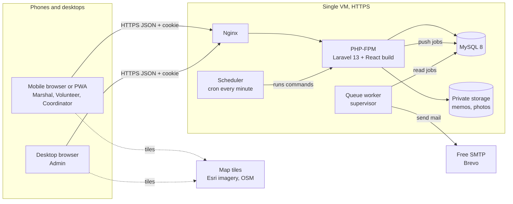
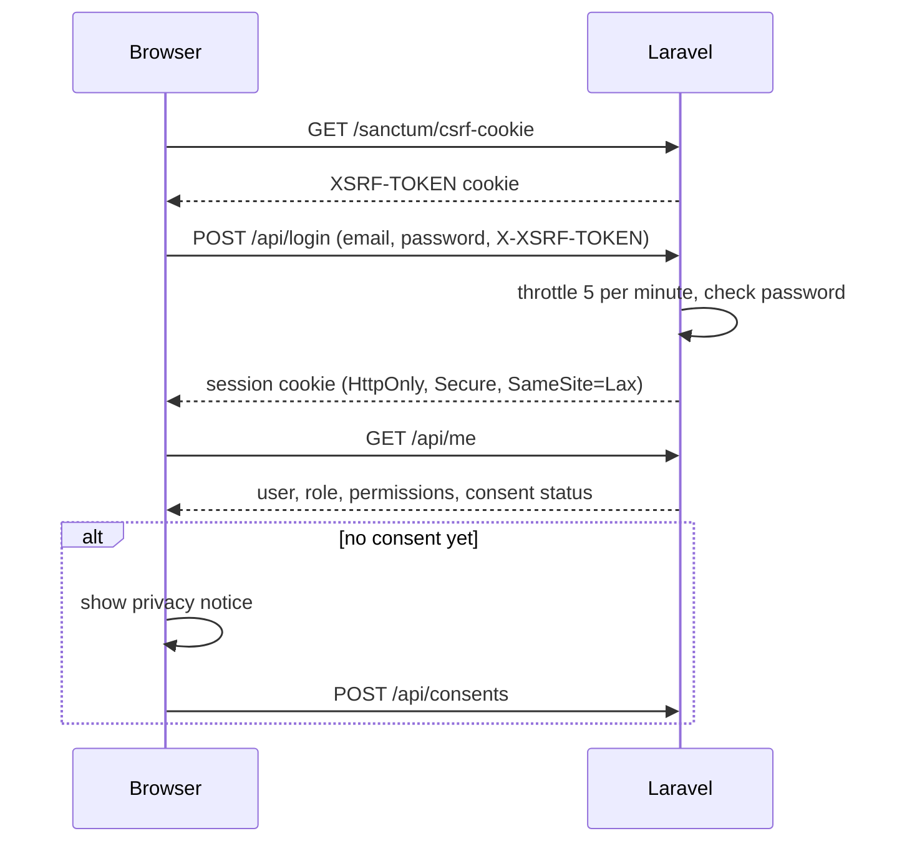
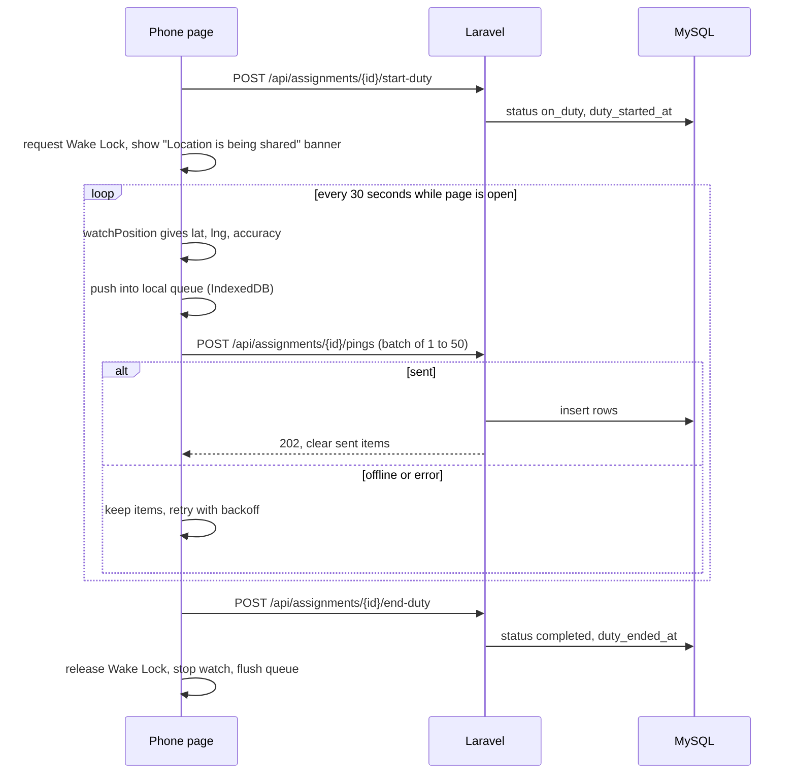
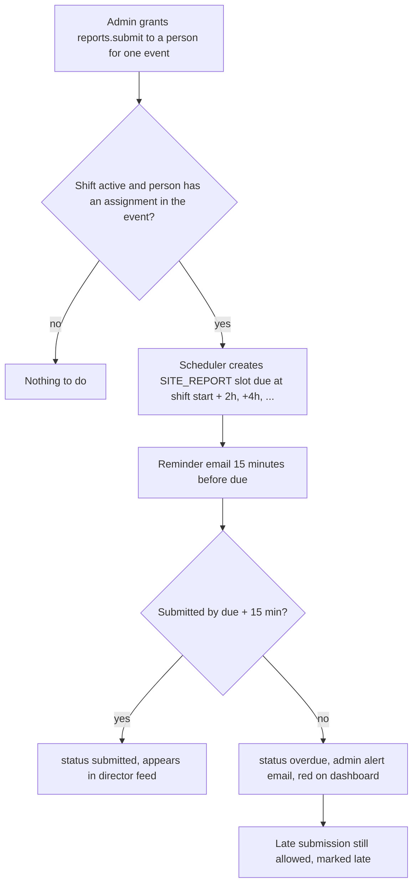

# Architecture

The system is one Laravel 13 application that also serves one React single page app. One server, one database, one queue worker, one cron entry. That is enough for 60 users.

## 1. System diagram



The queue uses the database driver, so there is no Redis to run. Cache and sessions also use the database. Tiles load straight from the tile provider into the browser and never touch our server.

## 2. Request flow

1. The browser loads `/` (or any app path). Laravel returns one Blade view that loads the Vite build.
2. React Router picks the page. The role in `/api/me` decides the default layout.
3. Pages call `/api/...` with `fetch` through one small client in `resources/js/shared/api`. The session cookie and the `X-XSRF-TOKEN` header go with every call.
4. Laravel runs middleware: `auth:sanctum`, `consented` (blocks everything except consent and logout until consent is given), throttle.
5. A Form Request validates input. A Policy or Gate decides access. A single-purpose Action class does the work and writes the audit entry when needed.
6. An API Resource shapes the JSON. Lists are paginated (25 per page by default).

## 3. Auth flow (Sanctum SPA cookie)

Because the React app and the API share one domain, Sanctum uses the normal Laravel session cookie. No tokens are stored in the browser.



- Admin creates accounts. The person receives a "set your password" email (Laravel password reset broker).
- Session lifetime: 8 hours of inactivity (`SESSION_LIFETIME=480`), so a long shift does not log anyone out. Laravel uses one lifetime for everyone, which keeps this simple.
- Logout invalidates the session and regenerates the CSRF token.

## 4. Queue and scheduler jobs

Cron runs `php artisan schedule:run` every minute. The scheduler pushes work onto the queue. One supervisor-managed worker runs `php artisan queue:work --tries=3 --backoff=60,300,900`.

| Job or command | When | What it does | Module |
|---|---|---|---|
| `SendNotificationJob` | On demand | Sends one queued email, updates the NOTIFICATION row to sent or failed | Notifications |
| `notifications:shift-reminders` | Every 5 minutes | Queues the evening-before (6:00 PM) and 1-hour-before reminders that are due and not yet sent | Notifications |
| `monitoring:create-report-slots` | Every 5 minutes | For each active shift with a designated reporter, creates the next SITE_REPORT slot and queues its reminder 15 minutes before due time | Monitoring |
| `monitoring:mark-overdue-reports` | Every 5 minutes | Marks slots overdue 15 minutes after due time and queues an admin alert | Monitoring |
| `events:mark-no-shows` | Every 15 minutes | Assignments still `assigned` or `acknowledged` 30 minutes after shift start are flagged on the dashboard. At shift end they become `no_show`. | Events |
| `monitoring:auto-end-duty` | Every 5 minutes | Ends duty for anyone still `on_duty` 30 minutes after shift end, so pings stop | Monitoring |
| `monitoring:purge-pings` | Daily 02:00 | Deletes pings older than 10 working days in chunks of 5,000 | Monitoring |
| `records:prune` | Daily 02:30 | Deletes stale sessions, old failed jobs, and anything else past its retention date | Records |
| `backup:database` | Daily 03:00 | `mysqldump` to a dated gzip file, keeps 14 days (see DEPLOYMENT.md) | Ops script, not Laravel |

Every scheduled command is idempotent. Running it twice does not send two emails or create two slots, because each uses a unique key (for example `unique(assignment_id, due_at)` on SITE_REPORT and a `type + assignment_id + scheduled_for` check on NOTIFICATION).

## 5. GPS ping flow



Rules on the server:

- Only the owner of an `on_duty` assignment can post pings to it.
- A ping is accepted if `captured_at` is between duty start minus 5 minutes and duty end plus 15 minutes. Late uploads from the offline queue are fine as long as the capture time is valid.
- Rate limit: 10 requests per minute per user on the ping endpoint. Batches mean one request carries many points.
- Readings with accuracy worse than 100 metres are stored but drawn as "low accuracy".

Honest limits, also shown to users:

- A web page can only read GPS while it is open and the screen is on. If the phone locks or the browser goes to the background, pings stop. Native background tracking is out of scope.
- Screen Wake Lock is re-requested every time the page becomes visible again, because the browser releases it when the tab is hidden. Support (caniuse, Nov 2026): Chrome 84+, Edge 84+, Safari and iOS Safari 16.4+, Firefox 126+, Samsung Internet 14+. Test on the actual phones the marshals use, including installed home screen apps on iPhone.
- Typical accuracy is about 5 to 15 metres outdoors, worse indoors.
- Geolocation and Wake Lock only work on HTTPS.

Load check: 60 people sending one point every 30 seconds is 120 rows a minute, or 2 inserts a second. Plain MySQL handles that easily. A busy 8-hour day is at most about 58,000 rows, roughly 6 MB with indexes. Ten working days of history stays well under 100 MB.

## 6. Site report schedule flow



## 7. One API, two layouts

- One React app in `resources/js`, built by Vite and served by Laravel.
- Two layout components: `AdminLayout` (sidebar, wide content, tables) and `MobileLayout` (top bar, bottom navigation with 4 items, one main action per screen).
- After login the role picks the default home: admins go to `/admin`, everyone else to `/me`.
- Layout follows screen width too. A marshal on a laptop sees their own pages in a centered, wider column. An admin on a phone gets a simplified read view of the dashboard, map and report feed.
- Both layouts use the same API endpoints. The API never changes shape based on device. It only filters based on permissions.
- Feature folders (see MODULES.md) hold the pages, hooks and API calls for one module, so the same hook can feed an admin table and a mobile card list.
- PWA: a web app manifest and a small service worker that caches the app shell only. API data is never cached by the service worker, so stale duty information cannot appear.

## 8. Map tiles and licence notes

- Library: Leaflet 1.9.x.
- Center: 6.91212, 122.05909 (ZPPSU main campus), default zoom 17, max zoom 18 for imagery.
- Layer 1, satellite: Esri World Imagery. Esri's own forum says the service "is not free, it can only be used with an ArcGIS Online or ArcGIS Enterprise license", and Esri's Leaflet FAQ says an API key from an ArcGIS Location Platform or ArcGIS Online account is needed for its location services. Plan: create a free ArcGIS Location Platform account and use its API key, and stay inside its free tier. The exact free basemap quota was not confirmed during planning, so check it in the Location Platform dashboard before launch. At 1 to 3 admins viewing one campus, usage will be tiny.
- Layer 2, streets: OpenStreetMap standard tiles. Allowed for light use under the OSM tile usage policy, with visible attribution "© OpenStreetMap contributors". No bulk downloading or offline caching of tiles.
- Attribution is always visible in the corner of the map. Do not hide it with CSS.
- If the Esri key is not available, the map still works with OSM only.

## 9. Folder layout overview

```
app/
  Modules/
    Personnel/  Access/  Events/  Notifications/  Monitoring/  Information/  Records/
  Support/            shared helpers owned by Core
resources/js/
  app/                router, providers, auth context (Core)
  layouts/            AdminLayout, MobileLayout (Core)
  shared/             api client, UI kit, hooks (Core)
  features/
    personnel/  access/  events/  notifications/  monitoring/  information/  records/
database/migrations/  one file per table, fixed prefixes per module (see DATABASE.md)
docs/
```

Details per module are in MODULES.md.
